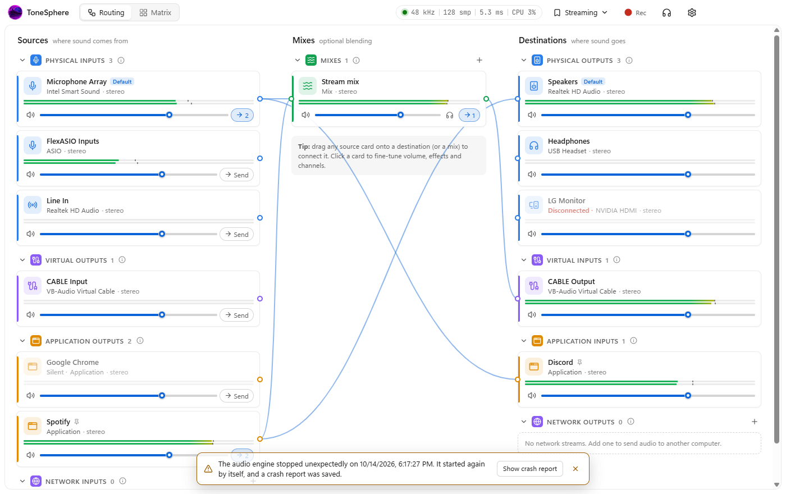

# Tone Sphere


**Route any audio anywhere: simple for everyone, deep enough for studios.** A free,
open-source audio router, mixer and VST3 host for Windows (and Linux), on a C++20 real-time
engine that uses every core it needs and none it doesn't.

[](https://github.com/AvishakeAdhikary/tone-sphere/releases/latest)
[](https://github.com/AvishakeAdhikary/tone-sphere/actions/workflows/ci.yml)
[](LICENSE)
[](https://github.com/sponsors/avishakeadhikary)
[](https://www.patreon.com/avishakeadhikary)
[](https://ko-fi.com/avishakeadhikary)
[](https://www.buymeacoffee.com/avishake69)



This is not your usual readme.

I am a guitarist, and I recently bought an audio interface, only to find out that playing or recording guitar requires me to pay again.
Honestly it was all cool and all, but I use Guitar Rig, which already is an expensive piece of software, not to mention the guitar itself is expensive enough, now I have a microphone and an audio interface.
But then comes the audio software bs that comes with it.
I was bored and frustated. I tried both Voicemeeter and Odeus Asio Link Pro.
Voicemeeter ran great, until it asked me to donate again and again, it felt a lot intrusive. I mean, why would I wait for 5 minutes if it is a donationware? Ffs it's donation ware, you either ask nicely or leave, not make people wait.
When I still waited, it became high latency out of nowhere. With VB audio cable of course.
Then I tried odeus asio link pro with asio. And honestly bro, wtf. That stuff was ancient and still no alternative to the date, it was an absolute chad.
But tbh I didn't like the approach, it was too complicated for beginners to grasp, to steep of a curve to just plug your guitar in to your audio interface and start playing.
I've had enough, so being a coder myself, I coded one on my own.

This project is all about that.

## What it does

Everything on your computer that makes or takes sound is sorted into six bins:

| Sources (sound comes from) | Destinations (sound goes to) |
|---|---|
| **Physical inputs**: microphones, line-ins, audio interfaces | **Physical outputs**: speakers, headphones, interface outputs |
| **Virtual outputs**: virtual speakers that other apps play into | **Virtual inputs**: virtual microphones that other apps record from |
| **Application outputs**: what each app plays (game, browser, Spotify, a DAW) | **Application inputs**: the microphone each app hears (Discord, Zoom, OBS, a DAW) |

To connect two things, drag a source onto a destination. Everything else is optional.

- **Hear your guitar in one click.** *Hear my instrument* picks your audio interface and your
  headphones and sends input 1 to both ears, at a safe level.
- **Routing.** Any source to any destination, through mixes ("Stream mix", "Monitor mix") with
  per-route volume, a channel matrix, mute/solo, pan, polarity and delay.
- **Clock sync.** Every device stays in step through adaptive drift compensation, including
  cheap USB interfaces that run 1 % slow: no slow drift, no clicks between devices.
- **Applications.** Capture any app's sound, give an app its own output, or feed a mix into an
  app's microphone.
- **ToneSphere ASIO driver.** Several DAWs (and Guitar Rig) can share one audio interface at
  once, 64- and 32-bit. ToneSphere also uses your interface's own ASIO driver, or FlexASIO or
  ASIO4ALL.
- **Effects and plugins.** Noise suppression (RNNoise), gate, EQ, compressor, limiter, auto-duck
  and delay, plus **VST3 effects and instruments** on any input, output or mix, with their own
  windows, an on-screen keyboard (A–K, Z/X for octaves) and your MIDI keyboard.
- **Multi-core engine.** Independent parts of the graph run on several cores at once when the
  effects are heavy, with exactly the same result as one core; light setups stay on one core
  for the lowest delay.
- **Network audio.** VBAN, compatible with VoiceMeeter.
- **Recording.** Multitrack WAV recording and an instant-replay buffer.
- **Control.** Scenes with global hotkeys, push-to-talk, OSC and MIDI controllers, a
  command-line tool, and an HTTP/WebSocket API for scripts.
- **Presets and skins.** Shareable routing maps that find devices by name and reconnect by
  themselves; five built-in looks plus your own.
- **English and हिन्दी (Hindi).**
- **Diagnostics.** Round-trip latency measurement, per-device latency, drift and dropout
  statistics, and crash reports that stay on your computer.

ToneSphere is a clean-room successor to *ODeus ASIO Link Pro*: it keeps the power and drops the
confusion. See [docs/parity.md](docs/parity.md) for the feature-by-feature comparison, and
[docs/STATUS.md](docs/STATUS.md) for what is verified (with the evidence) and what is not yet.

## Install

| Platform | Download | Notes |
|---|---|---|
| Windows 10/11 (64-bit) | `ToneSphere-Setup-<version>.exe` from [Releases](https://github.com/AvishakeAdhikary/tone-sphere/releases/latest) | Installs the app and the ToneSphere ASIO driver. Needs nothing else installed. |
| Windows, no installer | `ToneSphere-<version>-win-x64-portable.zip` | Unzip and run `ToneSphere.exe`. |
| Linux (x86_64) | `ToneSphere-<version>-x86_64.AppImage` | Needs PipeWire. Virtual devices are native PipeWire nodes. |

Windows SmartScreen may say "Windows protected your PC" because the installer isn't code-signed
yet: choose **More info → Run anyway**.

**Virtual speakers and microphones on Windows** come from **VB-CABLE**, VB-Audio's free
(donationware) virtual cable. Open **Settings › Devices › Install drivers…** and ToneSphere
downloads the official package from vb-audio.com, checks it is signed by VB-Audio, and opens
VB-Audio's installer (choose *Install Driver*). VB-CABLE's licence doesn't allow building it into
another installer, so ToneSphere never bundles it. ToneSphere's own virtual audio driver is in
this repository too, but Windows only loads it once Microsoft has signed it.

## Build from source

Everything needed to build and test is installed by one script:

```powershell
.\scripts\setup-dev.ps1        # VS Build Tools (C++), Windows SDK + WDK, Node.js, FlexASIO, npm, Playwright
```

```powershell
# Windows
.\scripts\build.ps1 -Test            # engine, ASIO driver, tools, test plugins + unit tests (x64)
.\scripts\build.ps1 -Arch x86        # 32-bit ASIO driver
.\drivers\win\vad\build.ps1          # virtual audio driver package (test-signed, for the test VM)
cd ui; npm ci; npm run dev           # UI against the engine (or: npm run mock-engine)
cd ui; npm run dist:win              # desktop installer → ui\release\
cd ui; npm run dist:store            # Microsoft Store package → ui\release-store\
```

```bash
# Linux (or WSL)
scripts/setup-dev.sh                 # packages + Node.js
scripts/build-linux.sh               # engine + unit tests
scripts/package-linux.sh             # AppImage → ui/release/
```

[docs/DEVELOPMENT.md](docs/DEVELOPMENT.md) explains the whole setup, including the Hyper-V test VM,
and how to pick the work up again from a fresh clone.

## Tests

```powershell
.\tests\run-all.ps1                         # unit + integration suites + UI end-to-end (needs VB-CABLE + FlexASIO)
node tests\integration\linux-pipewire.mjs   # Linux engine inside WSL
.\vm\Test-InVM.ps1                          # virtual audio driver, inside the Hyper-V test VM
.\vm\Test-Installer.ps1 ; .\vm\Test-Msix.ps1 ; .\vm\Test-Wack.ps1
```

Integration suites play real audio through VB-CABLE and measure what comes out. Kernel-driver
tests only ever run inside the Hyper-V VM (`vm/`), never on the development PC.

## Releases

Every push to `main` runs [CI](.github/workflows/ci.yml): Windows and Linux builds, unit tests (and
ThreadSanitizer on the multi-core engine), the UI end-to-end tests, integration tests, a secret
scan, and the downloads themselves are installed on a clean machine and launched. When it is
green, CI publishes the release: the latest `v*` tag plus one patch version, or `[minor]` /
`[major]` in the commit message for more ([scripts/release-version.mjs](scripts/release-version.mjs)).

## Repository layout

```
engine/        C++20 audio engine: graph, multi-core scheduler, bridges, effects, VST3 host,
               backends (WASAPI, ASIO, PipeWire, VBAN), OSC/MIDI, WebSocket/HTTP JSON-RPC
ui/            Electron + React app (bins, matrix, inspector, settings, splash) and packaging
drivers/win/   ToneSphere ASIO driver (user mode) and virtual audio driver (kernel, WaveRT)
shared/        Engine ⇄ UI protocol (PROTOCOL.md; TypeScript types live in ui/src/shared)
presets/       Ready-made routing presets (.tonesphere.json) and how to use them
tools/         tonesphere-ctl (CLI), tonesphere-setup (driver installer), audio-probe, asio-test-host
tests/         Integration suites (Node) that drive the real engine with real audio
vm/            Hyper-V test VM automation
scripts/       Build, setup and release scripts
packaging/     Microsoft Store listing and submission guide
docs/          STATUS.md (verified / pending), DEVELOPMENT.md, parity.md, legal/ (the Pages site)
assets/        The ToneSphere logo and banner
```

## Remote control

**OSC.** Turn on *Settings › Control › Allow OSC control* (UDP port 9000 by default). Then send:

```
/tonesphere/volume "Stream mix" 0.75     /tonesphere/mute "Microphone"      (toggle)
/tonesphere/gain   "Speakers"  -6.0      /tonesphere/scene "Gaming"
/tonesphere/record 1                     /tonesphere/replay
```

**MIDI.** In *Settings › Control*, choose an action, press **Learn** and move a knob, fader or
pad. For an instrument plugin, switch on *My MIDI keyboard plays this*.

**Command line.** `node tools/tonesphere-ctl.mjs state`, plus `connect`, `tone`, `meters` and raw `call`.

**Scripts.** One JSON-RPC request per HTTP POST to the engine (port and token in
`%LOCALAPPDATA%\ToneSphere\engine.json`):

```powershell
$d = Get-Content "$env:LOCALAPPDATA\ToneSphere\engine.json" | ConvertFrom-Json
Invoke-RestMethod -Method Post "http://127.0.0.1:$($d.port)/rpc" -Headers @{Authorization="Bearer $($d.token)"} `
  -ContentType application/json -Body '{"id":1,"method":"engine.getState"}'
```

[shared/protocol/PROTOCOL.md](shared/protocol/PROTOCOL.md) lists every method.

## A note on how this was rebuilt

An earlier version of this README advertised ASIO, WASAPI, ALSA, PulseAudio, JACK, PipeWire
and CoreAudio support, virtual audio devices, real-time effects and low-latency processing.
None of it worked. The eight driver classes each returned an array of zeros instead of
talking to an audio API; the "virtual audio devices" were Python queues; routing reported
success into an empty registry; and the UI displayed `CPU: 0% | Latency: 0ms` permanently,
which was not a reading of anything.

So there is one rule here now, and the test suite enforces it:

> **A feature does not exist until a test proves it moves audio.**
> And a measurement you did not take is reported as `--`, never as `0`.

That second half matters more than it sounds. `0.0` renders as a real, healthy-looking
number. Rendering `--` is the difference between a UI that tells you what it knows and one
that tells you what you want to hear.

**And then it was rebuilt again.** The Python version (0.1 to 0.2.1, tagged
[`legacy-python`](https://github.com/AvishakeAdhikary/tone-sphere/tree/legacy-python)) got the
engine working on Windows, but kept running into the same walls: a Python control plane next to
a real-time engine, no virtual devices other apps could pick, and an interface that was still a
patchbay for people who already knew what a patchbay is. So the whole thing was started again
from scratch, under a working name, as a C++20 engine with an Electron interface: six plain
bins instead of a patchbay, its own ASIO driver so Guitar Rig and DAWs can share one interface,
drift compensation for cheap USB interfaces, and the same rule about tests. When it worked
better than the original, it took over the original's name, logo and repository. Both histories
are in this repository.

## Sponsor

Everything here is free, and it stays free. No feature is time-limited, no dialog waits five
minutes before letting you through, and nothing is held back until you pay. The whole reason
this project exists is that I got tired of exactly that.

If it replaced something you would otherwise have had to buy, you can put that toward the
next release:

- **GitHub Sponsors**: [github.com/sponsors/avishakeadhikary](https://github.com/sponsors/avishakeadhikary)
- **Patreon**: [patreon.com/avishakeadhikary](https://www.patreon.com/avishakeadhikary)
- **Ko-fi**: [ko-fi.com/avishakeadhikary](https://ko-fi.com/avishakeadhikary)
- **Buy Me a Coffee**: [buymeacoffee.com/avishake69](https://www.buymeacoffee.com/avishake69)

It buys no feature and no priority. It buys time to work on this.

## Legal

Published by **Neural Nexus Studios**, Kolkata, West Bengal, India. No accounts, no telemetry,
nothing collected. Audio leaves your machine only through a network stream you set up yourself.

- [Terms and Conditions](docs/legal/terms-and-conditions.md): use of the application itself.
- [Terms of Service](docs/legal/terms-of-service.md): what it provides, support, updates, the
  optional network features, Microsoft Store distribution.
- [Privacy Policy](docs/legal/privacy-policy.md): what stays local, and the exceptions you choose.

The same three are published as a site at
[avishakeadhikary.github.io/tone-sphere](https://avishakeadhikary.github.io/tone-sphere/),
which is the address to hand to the Microsoft Store as the privacy policy URL.

## Licence

ToneSphere is free software under the **GNU General Public License v3.0 or later** (see
[LICENSE](LICENSE)). Every release carries its complete source as `ToneSphere-<version>-source.zip`.
Versions up to 0.2.1 (the Python implementation) were MIT-licensed and keep that licence.

Third-party components: ASIO SDK (GPLv3), VST3 SDK (MIT), RNNoise (BSD-3), nlohmann/json (MIT),
Catch2 (BSL-1.0), Electron and React (MIT), JetBrains Mono (SIL OFL 1.1). The virtual audio driver
is based on Microsoft's SimpleAudioSample (MS-PL; see `drivers/win/vad/LICENSE-MS-PL.txt`).
VB-CABLE is VB-Audio's software under VB-Audio's licence and is not part of ToneSphere.

ASIO and VST are trademarks of Steinberg Media Technologies GmbH. ToneSphere is not affiliated
with ODeus, VB-Audio or Steinberg.

## Contributing

Contributions welcome, under the GPLv3 with a DCO sign-off ([CONTRIBUTING.md](CONTRIBUTING.md)).
[AGENTS.md](AGENTS.md) holds the project's rules, for people and coding agents alike. Run
`.\tests\run-all.ps1` before trusting any change to the audio path; CI runs the rest on every
push and pull request.

If you add a backend, an effect or a control, add a test that asserts a known signal comes
out the other side at the expected amplitude. Several real bugs, in both rebuilds, were caught by
exactly that kind of test and by nothing else.

P.S. This is not a rickroll.
Installers build and get smoke-tested in CI, installed on a clean machine and launched the way
you would launch them, and every green push to main publishes a release. Still busy working in
corporate. Inviting others to contribute.
Have fun.
